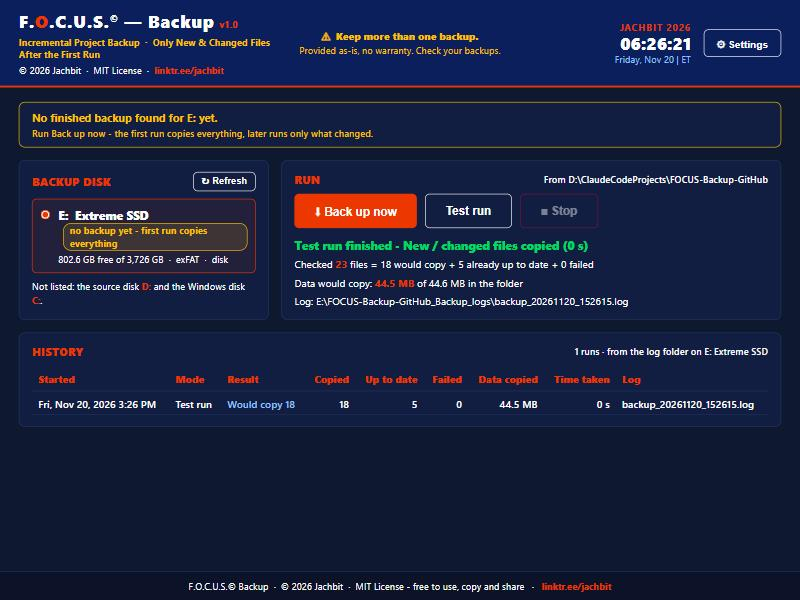

# F.O.C.U.S.© Backup

**Back up a folder to an external disk. The first run copies everything; every run after that copies only the files that are new or changed** — so a normal backup takes seconds, not hours.

A small Windows app in its own window. It runs only on your PC — nothing is uploaded anywhere.



## Download

1. Go to **[Releases](https://github.com/jachbit/FOCUS-Backup/releases/latest)** and download **`FOCUS-Backup.exe`**.
2. Put it in its own folder (for example `Documents\FOCUS-Backup`) — it saves its settings next to itself.
3. Double-click it. The **F.O.C.U.S.© Backup** window opens (it takes 2–3 seconds the first time).

No Python or install needed. Windows 10 / 11 only. It uses **Microsoft Edge WebView2**, which is already part of Windows 11 and up-to-date Windows 10; on an older PC without it, the app tells you and opens Microsoft's free download page.

> **"Windows protected your PC"?** Windows shows this for any new app downloaded from the internet that is not signed by a paid certificate. Click **More info → Run anyway**. The full source code is in this repo, and you can build the .exe yourself (see below).

## How to use

1. **⚙ Settings → Folder to back up** — pick it from the list or click **📁 Browse…**.
2. **Plug in your external disk.** It appears under **Backup disk** within a few seconds.
3. Click **⬇ Back up now**. The first run copies everything; after that, only changes.

| Button | What it does |
|---|---|
| **⬇ Back up now** | Copies new and changed files to the disk |
| **Test run** | Lists what *would* copy — copies nothing |
| **■ Stop** | Stops a running backup. The next run picks up the rest |

The **History** table lists every run (files copied, data, time taken) and the top strip turns yellow when your last backup is older than the limit you set (7 days by default).

To stop the app, close its window. If a backup is still running, it asks first — files already copied stay on the disk and the next run copies the rest.

## How it decides what to copy

It uses Windows' built-in **robocopy**. For every file it compares the **size** and the **last-modified time** with the copy on the disk:

| On the disk | What happens |
|---|---|
| Not there yet | Copied (**New File**) |
| Size or modified time differs | Copied over the old copy (**Newer** / **Older**) |
| Same size and time | Skipped (**Up to date**) |

It never reads file contents to compare, which is why checking tens of thousands of files takes seconds. A 2-second time tolerance keeps exFAT / FAT32 disks from re-copying everything.

**Files you delete stay in the backup** (safest: an accidental delete is not copied). Turn on **Mirror deletes** in Settings if you want the backup to match exactly.

## Settings

| Setting | Default | Notes |
|---|---|---|
| Folder to back up | — | Required on first run |
| Backup folder | `<folder name>_Backup` | Created by itself on the disk; logs go to `<name>_logs` next to it |
| Overdue after | 7 days | When the top strip turns yellow |
| Skip rebuildable folders | On | `node_modules`, `.venv`, `__pycache__`… — `npm install` / `pip install` brings them back |
| Show % progress | On | Checks what changed first (about 30 s extra) so the bar can show "X GB of Y GB" |
| Include secret files | **Off** | `.env`, `*.key`, `*.pem`, `*.token` stay on your PC unless you turn this on |
| Mirror deletes | Off | On = files you delete here are deleted from the backup too |

## Run from source / build the .exe

Needs Python 3.10+.

```bat
pip install -r requirements.txt
python server.py
```

To use your normal browser instead of the app window (handy while editing `templates/index.html`), run `set FOCUS_BROWSER=1` first.

To build `dist\FOCUS-Backup.exe` yourself, double-click **`build_exe.bat`** (it installs PyInstaller the first time).

## License

MIT © 2026 Jachbit — free to use, copy and share. Provided as-is, no warranty: **keep more than one backup and check them now and then.**

[linktr.ee/jachbit](https://linktr.ee/jachbit)
